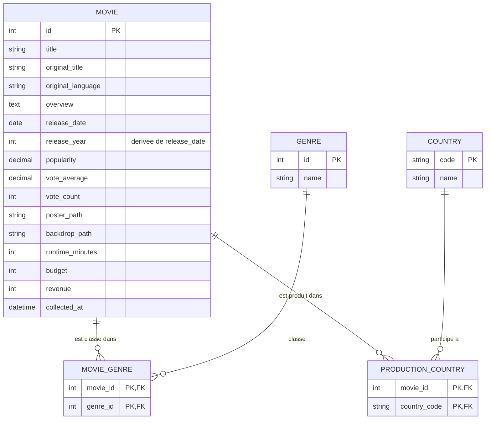

# Modèle de données du tableau de bord des films

Le modèle représente un échantillon de films TMDB destiné à être comparé par
année de sortie, genre et pays de production.

## MCD



Un film peut avoir zéro ou plusieurs genres et zéro ou plusieurs pays de
production. Un genre ou un pays peut être associé à zéro ou plusieurs films.
Les tables d'association représentent ces relations plusieurs-à-plusieurs.
L'identifiant TMDB d'un genre et le code d'un pays identifient les entrées de
catalogue ; le libellé n'est pas une clé.

Les notes, le nombre de votes, la popularité, la durée, le budget et les
recettes restent inconnus lorsqu'ils ne sont pas fournis. Une durée, un budget
ou une recette inconnus sont stockés à `NULL` ; lorsqu'ils sont présents, ils
sont strictement positifs. `release_year` est dérivée de `release_date` pour
faciliter les agrégations et les filtres par année.

Une actualisation conserve une seule ligne par film TMDB et remplace ses
associations de genres et de pays. `collected_at` correspond à la dernière
observation. Les clés étrangères garantissent que les associations pointent
vers des films et des entrées de catalogue existants.

## Schéma relationnel

```text
movies(
  id PK, title, original_title, original_language, overview, release_date,
  release_year, popularity, vote_average, vote_count, poster_path,
  backdrop_path, runtime_minutes, budget, revenue, collected_at
)

genres(id PK, name)
countries(code PK, name)
movie_genres(movie_id PK/FK -> movies.id, genre_id PK/FK -> genres.id)
production_countries(
  movie_id PK/FK -> movies.id,
  country_code PK/FK -> countries.code
)
```

Les clés primaires composites de `movie_genres` et `production_countries`
empêchent les doublons d'association. La suppression d'un film supprime ses
associations ; les entrées de catalogue référencées ne peuvent pas être
supprimées.
